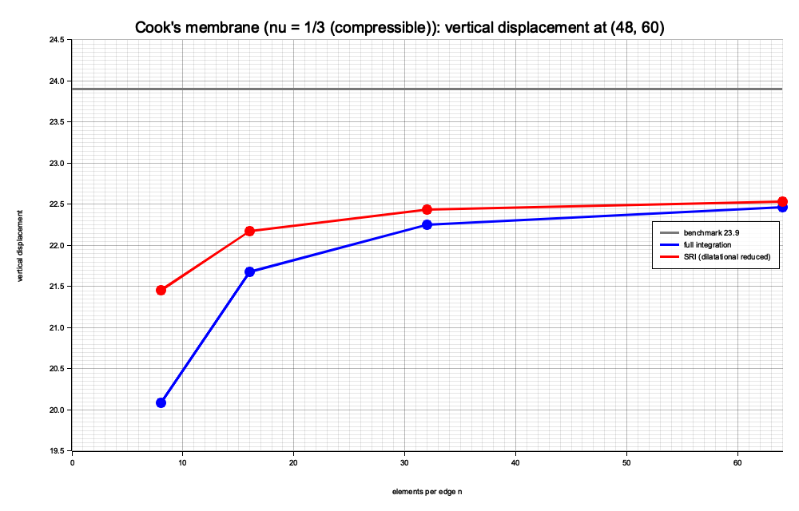
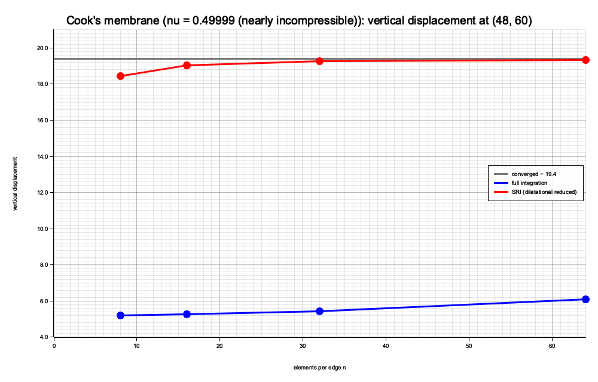

# Cook's membrane（平面应变）

Cook 膜（Cook's membrane）是检验二维单元在**弯曲主导**问题中表现的经典基准：一块梯形膜，一边固支、对边受均布剪力。它同时能暴露 4 节点双线性四边形的**剪切锁定**与**体积锁定**，因此常用来比较完全积分与选择性减缩积分（SRI）。

本算例在结构化 `Quad4` 网格上求解 Cook 膜，对比**完全积分**与 **SRI** 下参考点竖向位移随网格加密的收敛，并给出两种材料情形的收敛对比图：

- $\nu = 1/3$（可压缩）：主导误差为**剪切锁定**，基准值 $23.9$；
- $\nu = 0.49999$（近不可压缩）：主导误差为**体积锁定**，SRI 带来显著改善，参考值 $\approx 19.4$。

理论见「线弹性力学」，算子实现见 `src/operation/elasticity.rs`。

## 1. 问题设定

梯形膜的四个顶点（单位 mm）：

| 点 | 坐标 |
|---|---|
| $A$ | $(0,\ 0)$ |
| $B$ | $(48,\ 44)$ |
| $C$ | $(48,\ 60)$ |
| $D$ | $(0,\ 44)$ |

- **几何**：底边 $A\to B$、右边 $B\to C$（长度 16）、顶边 $C\to D$、左边 $D\to A$（长度 44）；
- **边界条件**：左边 $x=0$ **固支**（$u=v=0$）；
- **荷载**：右边 $x=48$ 施加沿 $+y$ 的**均布剪力**，合力 $F=1$ N（单位长度剪力 $1/16$）；
- **材料**：$E=1$、$\nu=1/3$，**平面应变**，厚度 1；
- **参考量**：右上角 $C=(48,60)$ 的**竖向位移**，基准值 $23.9$。

问题无体力，左端本质边界用罚函数法（$\alpha=10^7$）强加，右端剪力用 `traction` 施加。

## 2. GMSH 网格

几何文件 `examples/msh/cook.geo` 用 transfinite 映射生成结构化四边形网格，参数 `n` 为每条边的单元数：

```bash
# 默认 n = 16
gmsh -2 examples/msh/cook.geo -format msh4 -o examples/msh/cook.msh
```

收敛研究使用 $n=8,16,32,64$ 四套网格（`examples/msh/cook_8.msh` … `cook_64.msh`），由同一几何文件改 `n` 生成。物理组为 `Ω`（四边形）、`Γu`（左端）、`Γt`（右端）。

## 3. 有限元格式：完全积分与 SRI

**完全积分**直接调用

```rust
let triplets = stiffness(&units, lambda, mu);   // Quad4 的 2×2 Gauss
```

**SRI（选择性减缩积分）**把体积项与偏量项分开组装（见「线弹性力学」的体积–偏量分解）：

```rust
let bulk = bulk_modulus::<2>(lambda, mu);       // K = λ + 2μ/D
let mut triplets = dilatational_stiffness(&units, bulk); // 减缩 1 点积分
triplets.extend(deviatoric_stiffness(&units, mu));       // 2×2 完全积分
```

其中

$$
a\_{\mathrm{dil}}(u,v) = \int\_\Omega K (\nabla\cdot u)(\nabla\cdot v) d\Omega,
\qquad
a\_{\mathrm{dev}}(u,v) = \int\_\Omega 2\mu \varepsilon'(u):\varepsilon'(v) d\Omega,
$$

且 $K=\lambda+2\mu/D$、$\varepsilon'=\varepsilon-\frac{1}{D}(\operatorname{tr}\varepsilon)I$。完全积分对体积项也做 2×2 积分，在近不可压缩时会导致**体积锁定**；SRI 对体积项用 1 点积分，可缓解这一现象，而偏量项保持完全积分。

平面应变下 $\lambda=E\nu/[(1+\nu)(1-2\nu)]=0.75$、$\mu=E/[2(1+\nu)]=0.375$、$K=\lambda+\mu=1.125$。

## 4. 结果（$\nu = 1/3$）

运行：

```bash
cargo run --example cook
```

程序对四套网格分别组装、求解并提取 $C$ 点竖向位移，同时把收敛曲线渲染到 `target/cook_convergence.png`。

| $n$ | 单元数 | 自由度 | 完全积分 $v_C$ | SRI $v_C$ |
|---|---|---|---|---|
| 8 | 64 | 162 | 20.0884 | 21.4569 |
| 16 | 256 | 578 | 21.6794 | 22.1749 |
| 32 | 1024 | 2178 | 22.2513 | 22.4333 |
| 64 | 4096 | 8450 | 22.4621 | 22.5335 |
| 基准 | — | — | 23.9 | 23.9 |



> 图中 `book/src/cook_convergence.png` 即示例生成的 `target/cook_convergence.png` 的副本；重新运行示例即可更新。

## 5. 讨论（$\nu = 1/3$）

- **SRI 始终高于完全积分**：在所有网格上 SRI 的 $v_C$ 都更接近基准值，粗网格（$n=8$）上差距最明显（$21.46$ 对 $20.09$）。这说明减缩体积项确实软化了单元、减轻了锁定。
- **收敛趋势**：随 $n$ 增大，两条曲线都单调上升并相互靠近；$n=64$ 时相差已不足 $0.1$。SRI 的曲线在粗网格上已接近平台，而完全积分需要更细的网格才能追上。
- **与基准值的差距**：即使 $n=64$，两者仍低于 $23.9$ 约 $6\%$。这来自 4 节点双线性单元在弯曲主导问题中的**剪切锁定**（SRI 只处理体积锁定），以及左端固支与自由边交界处的**角点应力奇异**使低阶单元收敛缓慢。要完全消除该差距需要更高阶单元（如 Q8/Q9）或 EAS/混合格式。
- **结论**：SRI 以极小的实现代价（只需把体积项换成减缩积分）显著改善了粗网格精度，是缓解体积锁定的标准手段；但对剪切锁定无能为力。

## 6. 近不可压缩情形（$\nu = 0.49999$）

把泊松比推到 $0.49999$，材料接近不可压缩（$K=\lambda+\mu\approx 3.3\times10^4$，而 $\mu\approx 1/3$），体积锁定变得非常严重。示例对同一组网格重复上述流程（`solve` 的 `nu` 参数取 $0.49999$），结果如下：

| $n$ | 单元数 | 自由度 | 完全积分 $v_C$ | SRI $v_C$ |
|---|---|---|---|---|
| 8 | 64 | 162 | 5.2099 | 18.4376 |
| 16 | 256 | 578 | 5.2648 | 19.0300 |
| 32 | 1024 | 2178 | 5.4493 | 19.2558 |
| 64 | 4096 | 8450 | 6.0816 | 19.3491 |
| 参考 | — | — | — | $\approx 19.4$ |



> 图中 `book/src/cook_incompressible.png` 即示例生成的 `target/cook_incompressible.png` 的副本。

**完全积分几乎「锁死」**：网格从 $8\times8$ 加密到 $64\times64$，$v_C$ 只从 $5.21$ 增到 $6.08$；即使加密到 $n=128$ 也只有约 $7.88$，远低于正确量级。原因是体积模量 $K$ 极大，完全积分的体积项对离散体积变化施加了过强约束（**体积锁定**），位移被严重低估。

**SRI 恢复正确响应**：把体积项改为 1 点减缩积分后，$v_C$ 从 $18.44$ 迅速收敛到 $19.35$（$n=128$ 时约 $19.39$），与文献中该近不可压缩 Cook 膜的参考值 $\approx 19.4$ 一致。

> $23.9$ 是 $\nu=1/3$ 的基准值，不适用于本近不可压缩情形；两种材料的解不同，这里用 $\approx 19.4$ 作为参考。

对比两图可以清楚看到：$\nu=1/3$ 时两种积分差别不大（约 $6\%$），因为主导误差是剪切锁定；而 $\nu\to 0.5$ 时体积锁定成为主导，SRI 的价值才充分体现——这正是选择性减缩积分的设计目的。

## 7. 复现

```bash
# 重新生成网格
gmsh -2 examples/msh/cook.geo -format msh4 -o examples/msh/cook.msh

# 运行两种材料情形的收敛对比并生成两幅图
cargo run --example cook
#   -> target/cook_convergence.png       (nu = 1/3)
#   -> target/cook_incompressible.png    (nu = 0.49999)
```
