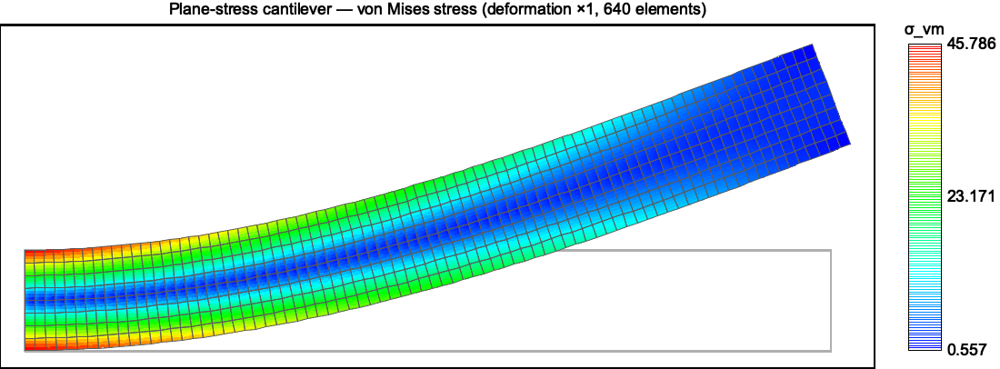

# 悬臂梁算例（cantilever）

本算例在平面应力悬臂梁网格上组装并求解线弹性问题，并用 `ansatz::operation::elasticity` 中的 L² 与能量范数误差算子，把数值解与 Saint-Venant 精确解对比，验证整条弹性组装链路。理论推导见「悬臂梁的力学模型（平面应力）」；算子理论见「线弹性力学」。

## 运行

```bash
cargo run --example cantilever
```

示例源码位于 `examples/cantilever.rs`，网格位于 `examples/msh/cantilever.msh`。程序在求解并打印误差后，还会用 [`plotters`](https://github.com/plotters-rs/plotters) 生成**变形应力云图** `target/cantilever_stress.png`。可传入可选的网格路径与输出路径参数做加密研究或另存图片：

```bash
cargo run --example cantilever -- examples/msh/cantilever.msh target/cantilever_stress.png
```

> `plotters` 是 `dev-dependencies`，仅用于示例可视化，库本身不依赖它。

## 网格

网格由 GMSH 几何文件 `examples/msh/cantilever.geo` 生成：

- 域为 $[0, L]\times[-H/2, H/2]$，取 $L = 8$、$H = 1$；
- 采用**结构化（transfinite）四边形网格**，$n_L \times n_H = 80 \times 8$ 个 `Quad4` 单元；
- 物理组：`"Ω"`（内部四边形）、`"Γu"`（左端，本质边界）、`"Γt"`（右端，自然边界）；上下表面不设物理组，即自由面。

重新生成网格（需安装 GMSH）：

```bash
gmsh -2 examples/msh/cantilever.geo -format msh4 -o examples/msh/cantilever.msh
```

## 组装与求解链路

示例严格对应「悬臂梁的力学模型（平面应力）」第 5 节的映射：

```rust
// 平面应力材料常数：λ* = Eν/(1−ν²)，μ = E/(2(1+ν))
let lambda = plane_stress_lambda(E, NU);
let (_, mu) = lame_constants(E, NU);

// 单元刚度 K_{(a,p),(b,q)} = ∫ [λ ∂ₚNₐ ∂_qN_b + μ(δ_pq ∂ₖNₐ ∂ₖN_b + ∂_qNₐ ∂ₚN_b)] dΩ
let mut triplets = stiffness(&units, lambda, mu);

// 左端：精确位移（本质边界条件，罚函数法）
let (pt, pd) = displacement_penalty(&left, alpha, exact_displacement);
triplets.extend(pt);

// 右端：抛物线剪力（自然边界条件）
doublets.extend(traction(&right, exact_traction));
```

随后由 faer 的 `SparseColMat::try_new_from_triplets` 合并三元组、`sp_cholesky` 求解。

## 误差验证算子

`src/operation/elasticity.rs` 新增两个误差算子，均基于 `Element::derivative_shape` 返回的物理梯度、`IntegrationScheme` 的积分点与权重，按张量（指标求和）形式实现：

- `l2_error(v, u_h, u)`：
  $\|u_h - u\|_{L^2} = \left(\int_\Omega |u_h - u|^2\,d\Omega\right)^{1/2}$，
  $u_h$ 为 `(node id, component)` 到节点位移的映射。

- `energy_error(v, u_h, strain, λ, μ)`：能量范数误差
  $\|u_h - u\|_E = \left(\int_\Omega \Delta : \mathbf C : \Delta\,d\Omega\right)^{1/2}$，$\Delta = \varepsilon_h - \varepsilon$。
  被积函数用各向同性形式 $\Delta : \mathbf C : \Delta = \lambda(\Delta_{kk})^2 + 2\mu\,\Delta_{ij}\Delta_{ij}$ 直接计算（对重复指标求和）；平面应力时传 $\lambda^* = E\nu/(1-\nu^2)$、$\mu$ 不变。

示例中：

```rust
let l2 = l2_error(&units, |id, p| d[id * 2 + p], exact_displacement);
let energy = energy_error(&units, |id, p| d[id * 2 + p], exact_strain, lambda, mu);
```

## 结果

取 $E = 1000$、$\nu = 0.3$、$P = 1$、$L = 8$、$H = 1$，$80 \times 8$ 网格的运行结果：

```text
== plane-stress cantilever beam ==
  mesh: 640 quadrilateral elements, 1458 DOFs
  tip deflection  FE = (5.069774e-13, 2.058744e0), exact = (-0.000000e0, 2.070000e0)
  L2 error        : 1.552813e-2
  energy-norm error: 1.063955e-1
```

端部挠度数值解 $2.0587$ 与精确解 $2.07$ 相差约 $0.5\%$；横向位移 $u \approx 0$（量级 $10^{-13}$）与理论一致。

### 网格加密（收敛性）

精确位移场含三次项，双线性 `Quad4` 不能精确表示，因此误差非机器零，但随网格加密稳定下降。下表为不同分辨率的误差（同一几何文件调整 `nL`、`nH`）：

| 网格 | 单元数 | $\|u_h-u\|_{L^2}$ | 能量范数误差 | 端部挠度 $v(L,0)$ |
|---|---|---|---|---|
| $40 \times 4$ | 160 | $6.14\times10^{-2}$ | $2.11\times10^{-1}$ | 2.0255 |
| $80 \times 8$ | 640 | $1.55\times10^{-2}$ | $1.06\times10^{-1}$ | 2.0587 |
| $160 \times 16$ | 2560 | $3.81\times10^{-3}$ | $5.33\times10^{-2}$ | 2.0672 |
| $240 \times 24$ | 5760 | $1.63\times10^{-3}$ | $3.56\times10^{-2}$ | 2.0688 |
| 精确解 | — | 0 | 0 | 2.0700 |

$L^2$ 误差约按 $O(h^2)$ 下降，端部挠度单调收敛到精确值 $2.07$。这既验证了 `stiffness`、`displacement_penalty`、`traction` 三个算子的正确性，也验证了 `l2_error`、`energy_error` 误差算子本身。

## 变形应力云图

示例末尾调用 `plot_deformed_stress`（基于 `plotters` 的 `BitMapBackend` / `Polygon` / `Rectangle` / `PathElement` / `Text`）绘制云图，步骤如下：

1. **解与应力**：由节点位移 $\mathbf{u}_h$ 在每个单元中心（必要时细分为 $k\times k$ 个子胞）用 `derivative_shape` 求应变，再由平面应力本构得 $\sigma_{xx},\sigma_{yy},\sigma_{xy}$，取 von Mises 应力
   $\sigma_{\mathrm{vm}} = \sqrt{\sigma_{xx}^2 - \sigma_{xx}\sigma_{yy} + \sigma_{yy}^2 + 3\sigma_{xy}^2}$；
2. **变形**：节点坐标按 $\mathbf{x} + \text{scale}\cdot\mathbf{u}_h$ 变换（`scale = 1`，即真实变形）；
3. **云图**：以每个子胞的变形四边形为填充多边形，按 $\sigma_{\mathrm{vm}}$ 归一化后用蓝→红彩色映射上色，叠加变形网格边、未变形轮廓与右侧色标。

生成结果（$80\times8$ 网格，von Mises 应力）：



固定端应力最高（红），自由端最低（蓝），中性轴附近因 $\sigma_{xx}\to 0$ 而应力偏低，与解析解 $\sigma_{xx} = -P(L-x)y/I$、$\sigma_{xy} = \tfrac{P}{2I}(H^2/4 - y^2)$ 的分布一致。

> 图中 `book/src/cantilever_stress.png` 即示例生成的 `target/cantilever_stress.png` 的副本；重新运行示例即可更新。

## 与单元测试的关系

除本算例外，`src/operation/elasticity.rs` 内还包含端到端回归测试 `cantilever_beam_matches_analytic_solution`（读取同一网格、组装求解并断言误差上界），以及若干解析验证：

- `l2_error_is_zero_for_exactly_represented_field` / `energy_error_is_zero_for_exactly_represented_field`：线性位移场被常应变三角形精确表示时误差为机器零；
- `l2_error_matches_analytic_constant_field` / `energy_error_matches_analytic_uniaxial_field`：与手算解析值逐位对比。

`cargo test` 会一并运行这些测试。
